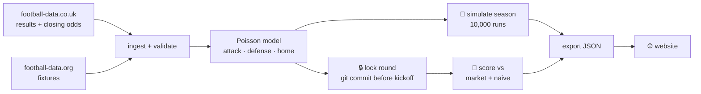

<div align="center">

# ⏱️ Fulltime

**Premier League match forecasts, locked before kickoff and scored against the betting market.**

[](https://predictingprem.vercel.app)
[](https://github.com/jk2962/fulltime/actions/workflows/lock.yml)


</div>

---

Most football predictions are hard to check. They get revised, quietly dropped, or judged on the misses that make headlines. Fulltime works the other way:

- 🔒 **Every forecast is committed to git before kickoff** and stamped with the commit of the code that made it. It is never edited afterwards.
- 📏 **Every forecast is scored** with the ranked probability score (RPS, lower is better).
- 🎯 **Every score sits next to the bookmakers' closing prices**, the hardest benchmark there is, and next to a naive baseline.

## 📊 Scoreboard

*2026-27 season, rounds 6-10 (50 matches), as of 10 Nov 2026. Live numbers are on the [site](https://predictingprem.vercel.app).*

| Forecaster | Mean RPS | |
|---|---:|---|
| 🏦 Bookmaker closing odds | **0.203** | the market, with all the late team news |
| ⏱️ **Fulltime** | **0.221** | locked 30h-1h before kickoff |
| 🎲 Naive baseline | 0.232 | historical home/draw/away rates |

Fulltime beats the naive baseline and trails the market. That's the expected order for a model that only sees past scorelines. It beat the market outright in rounds 8 and 10.

| Round | 6 | 7 | 8 | 9 | 10 |
|---|---:|---:|---:|---:|---:|
| Fulltime | 0.256 | 0.184 | **0.227** | 0.251 | **0.187** |
| Market | **0.207** | **0.150** | 0.232 | **0.233** | 0.195 |

## 🔮 What a forecast looks like

From the [round 10 lock](forecasts/2026-27/round-10.csv), committed on 5 Nov 2026, before any of these kicked off:

| Match | Home | Draw | Away | xG | Result |
|---|---|---|---|:---:|:---:|
| Arsenal v Hull | `███████░░░` 67% | `██░░░░░░░░` 22% | `█░░░░░░░░░` 11% | 1.8-0.6 | **1-0** ✅ |
| Leeds v Tottenham | `█████░░░░░` 46% | `██░░░░░░░░` 25% | `███░░░░░░░` 29% | 1.6-1.2 | **1-0** ✅ |
| Ipswich v Bournemouth | `██░░░░░░░░` 19% | `██░░░░░░░░` 20% | `██████░░░░` 61% | 1.1-2.2 | **1-2** ✅ |
| Nott'm Forest v Man City | `██░░░░░░░░` 24% | `██░░░░░░░░` 24% | `█████░░░░░` 52% | 1.1-1.7 | **3-1** ❌ |

Leeds v Tottenham was Fulltime's biggest edge of the round: an RPS of 0.187 against the market's 0.287. Forest beating City caught out everyone.

Each round also gets a simulated final table (10,000 seasons):

| Team | Points now | Expected final | Title | Top 4 | Relegated |
|---|---:|---:|---:|---:|---:|
| Arsenal | 24 | 83.9 | **74%** | 99% | 0% |
| Man City | 21 | 75.2 | 20% | 92% | 0% |
| Ipswich | 11 | 32.4 | 0% | 0% | **78%** |
| Coventry | 9 | 35.4 | 0% | 0% | **60%** |

## ⚙️ How it works



1. **Ingest.** Results and closing odds for every season since 2020-21, plus this season's fixtures. Team names are mapped through `data/teams.csv`. Validation fails loudly and never fixes data silently.
2. **Model.** An independent Poisson GLM gives each team an attack and a defense rating, plus one shared home advantage. It's fit on the last two years of matches and shrunk toward a prior; promoted teams get their own learned prior. Out come home/draw/away probabilities and expected goals.
3. **No leakage.** Training data comes only through `get_training_data(matches, before_utc)`, which keeps matches strictly before the cutoff. Closing odds are used only for scoring, never as a model input.
4. **Lock.** A GitHub Action checks every hour and locks each round between 30h and 1h before its first kickoff. The commit timestamp is the proof.
5. **Simulate.** Team ratings are drawn from their estimated uncertainty, and the rest of the season is played out 10,000 times.
6. **Score.** Once results are in, each forecast gets an RPS next to the market and the naive baseline.

### 🧪 Honest by design

- **The model can't be tweaked mid-season.** Changes happen only at checkpoints after rounds 10, 20 and 30. Each checkpoint can test at most two candidates named in advance, and a candidate is adopted only if it clears thresholds written before any backtest is run. The round 10 checkpoint tested two candidates and rejected both. Every decision, including "no change", is in [MODEL_NOTES.md](MODEL_NOTES.md).
- **Rounds 1-5 are labelled retrospective.** They were forecast after the fact (`retro-*` files) and don't count toward the scoreboard.
- **The model is never tuned to match the market.** The market is the benchmark, not the target.

## 🗂️ Repo layout

```
pipeline/    Python: ingest, validate, model, lock, simulate, score, export
tests/       pytest suite (tests/test_model.py is the model spec)
data/        teams.csv, manual_fixtures.csv; downloads go to data/raw/ (gitignored)
forecasts/   locked forecasts, season tables and scores.csv (the audit record)
web/         Next.js site; reads only the JSON in web/data/ (see web/README.md)
```

The pipeline and the site share nothing but the exported JSON.

## 🚀 Quick start

```bash
python3.12 -m venv .venv
.venv/bin/pip install -r requirements.txt
.venv/bin/pytest
.venv/bin/python -m pipeline.run --check     # load, validate, report baselines
```

For live fixtures, put a football-data.org token in a gitignored `.env` file as `FOOTBALL_DATA_API_KEY=...`. Never commit it. Without a token, fixtures come from `data/manual_fixtures.csv`.

Website:

```bash
cd web && npm install && npm run dev         # http://localhost:3000
```

<details>
<summary><b>All pipeline commands</b></summary>

```bash
.venv/bin/python -m pipeline.run --check      # load and validate data, report baselines
.venv/bin/python -m pipeline.run --backtest   # walk-forward check on the 2025-26 holdout
.venv/bin/python -m pipeline.run --forecast   # lock the next round; needs a clean working tree
.venv/bin/python -m pipeline.run --score      # score locked forecasts, rewrite forecasts/scores.csv
.venv/bin/python -m pipeline.simulate         # lock the season-table snapshot; needs a clean working tree
.venv/bin/python -m pipeline.retro            # rounds 1-5 after the fact (labelled on the site)
.venv/bin/python -m pipeline.tune             # PRIOR_STRENGTH grid; prints only, changes nothing
.venv/bin/python -m pipeline.export           # write web/data/*.json for the site
```

</details>

<details>
<summary><b>Locking rules in detail</b></summary>

`.github/workflows/lock.yml` runs `--lock-due` every hour. It locks the next round
between 30h and 1h before its first kickoff: on the first run where every earlier
result is in the data, or once kickoff is under 6h away. It then fails if a round
is under 2h from kickoff and still unlocked. Nothing locks within 15 minutes of kickoff.
The workflow reads the token from the `FOOTBALL_DATA_API_KEY` Actions secret and stops if it is missing.

Outside CI, without the token, fixtures come from `data/manual_fixtures.csv`
(columns `match_id,matchday,kickoff_utc,home,away`; kickoff like
`2026-10-10T11:30:00Z`; team names from the `canonical` column of `data/teams.csv`).

Locked files (`round-NN.csv`, `table-round-NN.csv`) are written once and never edited, regenerated or deleted.

</details>

---

<div align="center">
<sub>Data: <a href="https://www.football-data.co.uk">football-data.co.uk</a> (results, odds) · <a href="https://www.football-data.org">football-data.org</a> (fixtures). Not affiliated with the Premier League. Not betting advice.</sub>
</div>
